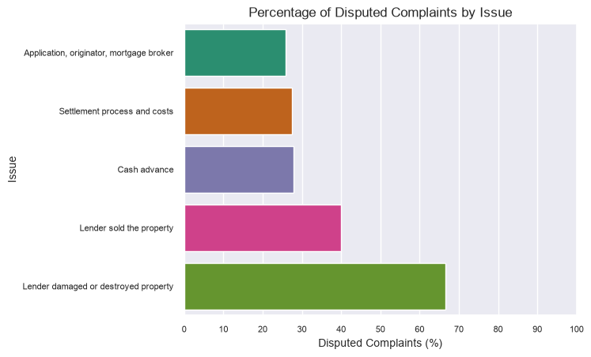
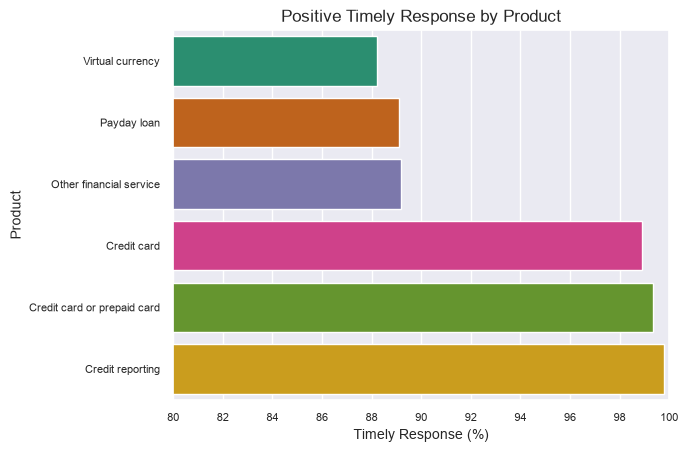
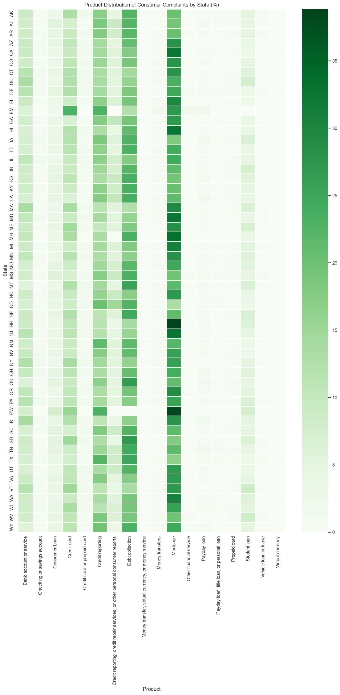
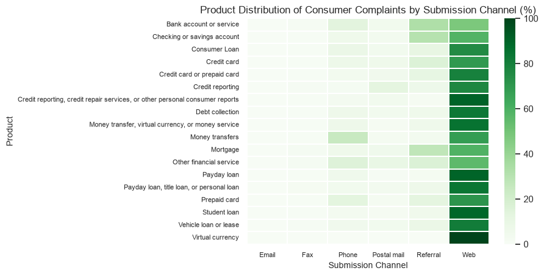

# Electricity Demand and Pricing

## 1. Project Overview

This project explores consumer complaints about financial products and services in the United States using the [Consumer Complaints Database](https://www.kaggle.com/datasets/sebastienverpile/consumercomplaintsdata) dataset.

The analysis focuses on identifying complaint patterns, understanding how complaint volumes evolve over time, and exploring the factors associated with consumer disputes and company response outcomes.

## 2. Problem Statement

This project aims to explore patterns in US consumer financial complaints to identify the products and issues most frequently associated with complaints, examine changes in complaint volumes over time, and investigate differences in company response outcomes across various factors.

## 3. Objectives

- Identify which financial products and services generate the highest number of consumer complaints.
- Analyze complaint volume trends over time and identify notable changes.
- Examine which complaint issues have the highest proportion of disputed responses.
- Investigate which factors are associated with companies providing timely responses.
- Compare complaint patterns across submission channels and geographical regions.

## 4. Research Questions

- Which financial products generate the most complaints?
- How have complaint volumes changed over time?
- Which issues have the highest share of disputed complaints?
- Which factors are associated with timely company responses?
- Are there differences by submission channel or region?

## 5. Hypotheses

- The number of complaints has generally increased over time.

## 6. Data Quality Assessment

The consumer_disputed column contains approximately 14% missing values. This is not random, as the CFPB discontinued its consumer dispute option in April 2017.

This column indicates whether a consumer disputed the company's response to their complaint (Yes or No).

Instead of removing rows with missing values, they will be preserved as another category - 'Not available'.

## 7. Analysis

### Which financial products generate the most complaints?

To understand which products generate the most complaints, I plotted the 18 products to see the number of complaints they have generated.

The highest number of complaints are generated by:

1. Mortgage - 239,642 **(26.88%)**
2. Debt collection - 169,743 **(19.04%)**
3. Credit reporting - 139,127 **(15.61%)**

### How have complaint volumes changed over time?

To understand how complaint volumes have changed over time, I first derrived two columns from the 'date_received' column - the month and the year.

To see the general trend, I plotted a line plot, and it's visible that number of complaints has a general upward trend.

To see it in more detail, I plotted each month for each year. This gives us more clarity about how many complaints have been filed each month.

The result aligns directly with the hypotheses - that the number of complaints has generally increased over time.

### Which issues have the highest share of disputed complaints?

To find out which isues have the highest share of disputed complaints, I grouped the data by issue, filtered rows where 'consumer_disputed' is positive, calculated the percentage for each issue, and got the 5 largest results.

Results:

1. Lender damaged or destroyed property - **66.67%**
2. Lender sold the property - **40.00%**
3. Cash advance - **27.80%**
4. Settlement process and costs - **27.49%**
5. Application, originator, mortgage broker - **25.86%**

### Which factors are associated with timely company responses?

To understand which factors are associated with timely company responses, I took a few approaches:

- Calculated timely responses grouped by submission channel.
- Calculated timely responses grouped by product.
- Calculated timely responses grouped by issue.

#### Submission channel

There are 6 submission channels available in the dataset: Phone, Email, Web, Fax, Referral, Postal mail.

Phone has the lowest timely response (96.88%), postal mail the highest (98.20%).

All of the channels are close in timely responses, therefore this isn't a strong factor for timely responses.

#### Product

There are 18 distinct products in the dataset. For the purpose of this question, I took the top 3 and bottom 3, grouped by timely response:

- Virtual currency **(88.24%)**
- Payday loan **(89.09%)**
- Other financial service **(89.18%)**
  ...
- Credit card **(98.90%)**
- Credit card or prepaid card **(99.36%)**
- Credit reporting **(99.79%)**

We can already start to see some pattern, where products are concerned.

Credit cards and reporting have the highest timely response. Whereas virtual currency has the lowest.

#### Issue

There are 166 distinct issues in the dataset. 34 of these issues have below 100 complaints - I didn't use them in this research as they skew the numbers.

Here are the results:

- Excessive fees **(85.59%)**
- Can't contact lender **(85.77%)**
- Received a loan I didn't apply for **(87.50%)**
- Charged bank acct wrong day or amt **(87.84%)**
- Taking/threatening an illegal action **(88.85%)**
  ...
- Credit reporting company's investigation **(99.88%)**
- Unable to get credit report/credit score **(99.90%)**
- Managing, opening, or closing your mobile wallet account **(100.00%)**
- Unauthorized transactions or other transaction problem **(100.00%)**
- Convenience checks **(100.00%)**

#### Conclusion

The analysis suggest that the product and the issue are more strongly associated with timely responses, than the submission channel.

Submission channels have little variation, all being between 96.88% and 98.20%. This suggests that the way complaints are being submitted has little to no effect to wether a company responds.

Products have a higher variation. Complaints connected to credit cards and reporting have a much higher positive timely response, compared to virtual currencies which are at the bottom. This indicated that the type of product involved may play a bigger factor.

The largest difference appears when examining issues. Excessive fees have the lowest percentage of timely response, with 85.59%. Whereas Convenience checks have 100% timely responses. Credit related issues also appear in the highest timely response rates.

Overall, the findings indicate that timely company responses vary primarily across product categories and, even more noticeably, individual complaint issues. Certain types of complaints consistently have lower response rates, suggesting that the nature of the complaint may be more relevant than how it was submitted.

### Are there differences by submission channel or region?

To understand if there are differences by submission channel or region, I took two approaches:

- Plotted a heatmap of product distribution of consumer complaints by state.
- Plotted a heatmap of product distribution of consumer complaints by submission channel.

#### States

Using the heat map, we can see that patterns between states stay relatively similar. Mortgage seems to be the product that generates the most complaints in most states, then debt collection and credit reporting

**This heat map shows normalized percentage per state. It does NOT conclude that Mortgages generate the absolute most amount of complaints.**

#### Submission channel

Using the heat map, we can see that patterns between submission channels stay relatively similar. Web is clearly the most preffered option to submit complaints, for all types of products.

#### Conclusion

In terms of products, there doesn't seem to be strong evidence that there are differenecs by submission channels or regions (states).
