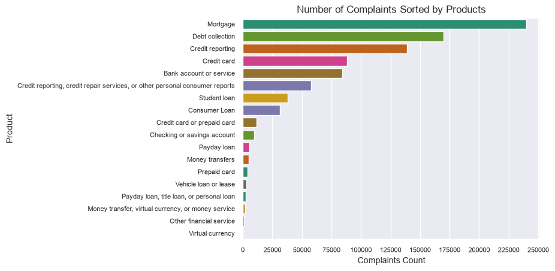
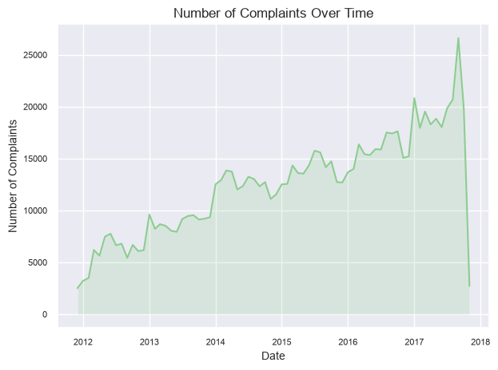
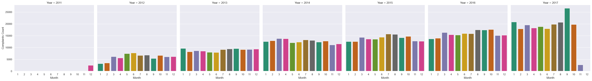

# Electricity Demand and Pricing

## 1. Project Overview

This project explores consumer complaints about financial products and services in the United States using the [Consumer Complaints Database](https://www.kaggle.com/datasets/sebastienverpile/consumercomplaintsdata) dataset.

The analysis focuses on identifying complaint patterns, understanding how complaint volumes evolve over time, and exploring the factors associated with consumer disputes and company response outcomes.

## 2. Problem Statement

This project aims to explore patterns in US consumer financial complaints to identify the products and issues most frequently associated with complaints, examine changes in complaint volumes over time, and investigate differences in company response outcomes across various factors.

## 3. Objectives

- Identify which financial products and services generate the highest number of consumer complaints.
- Analyze complaint volume trends over time and identify notable changes.
- Examine which complaint issues have the highest proportion of disputed responses.
- Investigate which factors are associated with companies providing timely responses.
- Compare complaint patterns across submission channels and geographical regions.

## 4. Research Questions

- Which financial products generate the most complaints?
- How have complaint volumes changed over time?
- Which issues have the highest share of disputed complaints?
- Which factors are associated with timely company responses?
- Are there differences by submission channel or region?

## 5. Hypotheses

- The number of complaints has generally increased over time.

## 6. Data Quality Assessment

The consumer_disputed column contains approximately 14% missing values. This is not random, as the CFPB discontinued its consumer dispute option in April 2017.

This column indicates whether a consumer disputed the company's response to their complaint (Yes or No).

Instead of removing rows with missing values, they will be preserved as another category - 'Not available'.

## 7. Analysis

### Which financial products generate the most complaints?

To understand which products generate the most complaints, I plotted the 18 products to see the number of complaints they have generated.

The highest number of complaints are generated by:

1. Mortgage - 239,642 (26.88%)
2. Debt collection - 169,743 (19.04%)
3. Credit reporting - 139,127 (15.61%)

### How have complaint volumes changed over time?

To understand how complaint volumes have changed over time, I first derrived two columns from the 'date_received' column - the month and the year.

To see the general trend, I plotted a line plot, and it's visible that number of complaints has a general upward trend.

To see it in more detail, I plotted each month for each year. This gives us more clarity about how many complaints have been filed each month.

The result aligns directly with the hypotheses - that the number of complaints has generally increased over time.
